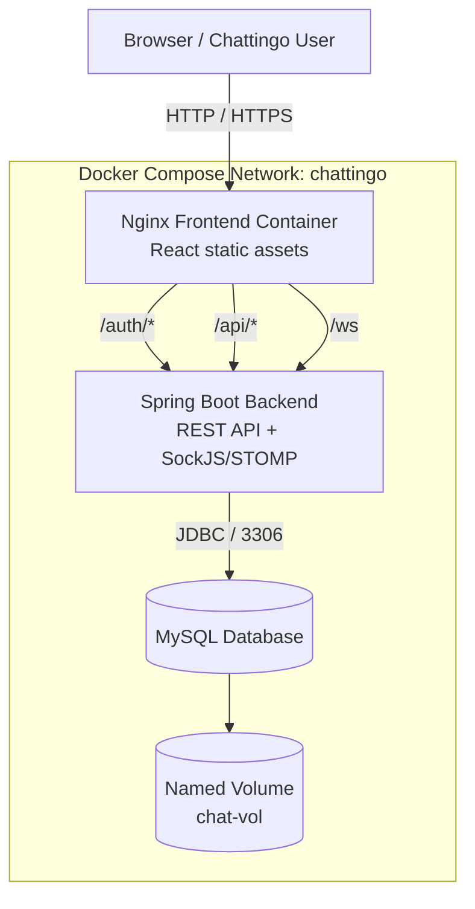

# 💬 Chattingo — Dockerized Real-Time Chat Application

Chattingo is a full-stack messaging application packaged with **Docker, multi-stage builds, Docker Compose, and Nginx**. This repository documents the deployment workflow for a React frontend, Spring Boot backend, and MySQL database—with REST API and SockJS/STOMP traffic routed through Nginx.


> 🎯 **Project focus:** containerization, service networking, environment-based configuration, persistent storage, image publishing, deployment verification, and troubleshooting. Containerization alone does **not** guarantee production readiness; review the security checklist before exposing the application publicly.

## 🚀 At a Glance

- 🖥️ **Frontend:** React single-page application served as static production files by Nginx.
- ⚙️ **Backend:** Spring Boot REST APIs, JWT authentication, and chat/message operations.
- ⚡ **Real-time transport:** SockJS/STOMP through the `/ws` endpoint.
- 🗄️ **Persistence:** MySQL with a named Docker volume.
- 🔀 **Reverse proxy:** Nginx routes `/auth/`, `/api/`, and `/ws` requests to the backend.
- 📦 **Deployment:** Docker multi-stage builds and Docker Compose.
- 🛠️ **Operations:** build, deploy, inspect logs, restart services, validate messaging, and publish images to Docker Hub.

## 🏗️ Architecture



### 🔌 Service map

| Service | Responsibility | Internal port | Recommended exposure |
|---|---|---:|---|
| `frontend` | Serves React assets and proxies requests | Match Nginx `listen` (commonly `80` or `8080`) | Public entry point on host port `80`/`443` |
| `backend` | REST APIs, authentication, chat and message logic, WebSocket endpoint | `8080` | Keep private on the Compose network where possible |
| `mysql` | Stores application data | `3306` | Internal Compose network only; do not expose publicly |

**⚠️ Port consistency matters:** the Nginx `listen` port, frontend container port, and Compose port mapping must agree. A complete `/etc/nginx/nginx.conf` and a server-only `/etc/nginx/conf.d/default.conf` are different file formats—do not interchange them.

## 🧰 Technology Stack

| Layer | Technologies |
|---|---|
| Frontend | React 18, Create React App, React Router, Redux |
| Real-time client | SockJS, STOMP.js |
| Backend | Java 17, Spring Boot 3.3.1 |
| API and persistence | Spring Web, Spring Data JPA, Hibernate |
| Security | Spring Security, JWT (JJWT 0.11.5), BCrypt password encoding |
| Database | MySQL — use the version configured in `docker-compose.yml` |
| Web server | Nginx reverse proxy and static-file server |
| Delivery | Docker, Docker Compose, multi-stage Dockerfiles, Maven, npm |

## 📁 Repository Structure

Your filenames and build contexts may differ slightly. **Make sure the Dockerfile paths in `docker-compose.yml` match the files that actually exist.**

```text
chattingo/
├── docker-compose.yml
├── .env                  # Local secrets; do not commit
├── .env.example          # Safe placeholder template
├── README.md
├── frontend/
│   ├── Dockerfile        # Or Dockerfile.multi; match Compose
│   ├── .dockerignore
│   ├── nginx.conf        # Full Nginx config, if used
│   ├── default.conf      # Server block, if used instead
│   ├── package.json
│   ├── package-lock.json
│   ├── public/
│   └── src/
└── backend/
    ├── Dockerfile        # Or Dockerfile.multi; match Compose
    ├── .dockerignore
    ├── pom.xml
    └── src/
```

## ✅ Prerequisites

- Linux workstation or server (deployment example: Ubuntu on AWS EC2).
- Docker Engine and the Docker Compose v2 plugin.
- Git, if cloning or updating the project.
- Network access to download base images and npm/Maven dependencies.
- Strong database credentials and a long, random JWT signing secret.

The multi-stage builds run Node.js and Maven in build stages; you do not need to install them directly on the deployment host.

Check the tools:

```bash
docker --version
docker compose version
git --version
```

Use `sudo` before Docker commands when your Linux user does not have permission to access the Docker daemon.

## ⚙️ Configure Environment Variables

Create a root-level `.env` file beside `docker-compose.yml` when Compose uses `${VARIABLE}` substitutions. Compose does **not** automatically load `backend/.env` for Compose-file interpolation. A service-specific environment file must be declared with `env_file:` if you choose that approach.

Example template — replace every placeholder before deployment:

```dotenv
# MySQL initialization
MYSQL_DATABASE=chattingo
MYSQL_USER=chattingo_app
MYSQL_PASSWORD=replace_with_a_strong_app_password
MYSQL_ROOT_PASSWORD=replace_with_a_different_root_password

# Spring Boot datasource
SPRING_DATASOURCE_URL=jdbc:mysql://mysql:3306/chattingo?serverTimezone=UTC
SPRING_DATASOURCE_USERNAME=chattingo_app
SPRING_DATASOURCE_PASSWORD=replace_with_a_strong_app_password

# Authentication and runtime
JWT_SECRET=replace_with_a_long_random_secret
SPRING_PROFILES_ACTIVE=prod

# Use the real browser origin when required by the app's CORS/WebSocket settings
CORS_ALLOWED_ORIGINS=http://YOUR_PUBLIC_HOST
CORS_ALLOWED_METHODS=GET,POST,PUT,DELETE,OPTIONS
```

### 🔑 Variable checklist

- `MYSQL_DATABASE`, `MYSQL_USER`, `MYSQL_PASSWORD`, `MYSQL_ROOT_PASSWORD` — database initialization and credentials.
- `SPRING_DATASOURCE_URL` — use the Compose hostname `mysql`, not `localhost`, from the backend container.
- `SPRING_DATASOURCE_USERNAME`, `SPRING_DATASOURCE_PASSWORD` — must match the application database user.
- `JWT_SECRET` — keep secret and stable across backend restarts; use a cryptographically strong value.
- `SPRING_PROFILES_ACTIVE` — select a profile only if the application defines it.
- `CORS_ALLOWED_ORIGINS`, `CORS_ALLOWED_METHODS` — take effect only if the application reads these properties.

> 📝 **Existing database volume:** MySQL image variables generally initialize a fresh data directory. Changing `MYSQL_USER` or `MYSQL_PASSWORD` later does not automatically update an existing database user's credentials. Update the MySQL user explicitly when reusing a persisted volume.

## 🌐 Service Communication

- **Browser → Nginx:** users access the public frontend origin; Nginx serves the React build.
- **Nginx → backend:** requests for `/auth/`, `/api/`, and `/ws` are forwarded to `backend:8080` over the Compose network.
- **Backend → MySQL:** Spring Boot connects to `mysql:3306` using JDBC.
- **Database → volume:** the `chat-vol` named volume preserves MySQL data when containers are recreated.

For a same-origin deployment, the browser-side API base URL should use relative paths rather than a Docker-only hostname or a hard-coded localhost URL:

```javascript
export const BASE_API_URL = process.env.REACT_APP_API_URL || "";
```

Create React App embeds `REACT_APP_*` values at **build time**. Rebuild the frontend image after changing frontend environment configuration or source code.

## 🚀 Build and Deploy

Run these commands from the project root, where `docker-compose.yml` lives.

### 1. Validate the Compose file

```bash
cd ~/chattingo
sudo docker compose config
```

Resolve missing variables, invalid YAML, and incorrect build paths before building. Avoid posting the rendered output publicly if it contains expanded secrets.

### 2. Verify the build context

```bash
ls -la frontend/
ls -la backend/
```

Check that every Dockerfile and Nginx config referenced by Compose exists. Ensure `.dockerignore` does not exclude required inputs such as `src/`, `public/`, `package-lock.json`, or the Nginx configuration.

### 3. Build and start

```bash
sudo docker compose build
sudo docker compose up -d
```

Rebuild a single service after changing its source or Dockerfile:

```bash
sudo docker compose build --no-cache frontend
sudo docker compose build --no-cache backend
sudo docker compose up -d
```

### 4. Check service state

```bash
sudo docker compose ps
sudo docker images
```

Confirm the frontend and backend remain running and MySQL is healthy, if a health check is configured, before testing the app.

## Deployment Verification

### 1. Frontend reachability

```bash
curl -I http://127.0.0.1/
```

For an external check, visit `http://YOUR_PUBLIC_HOST/` and confirm your host firewall and cloud security group allow inbound TCP port `80`. Configure HTTPS and a valid certificate before sending credentials over the public internet.

### 2. Authentication and API

The backend defines these authentication routes:

- `POST /auth/signup`
- `POST /auth/signin`

Use a unique test email address. Inspect response codes and browser DevTools → **Network** to verify that requests reach the backend. Do not share passwords, JWTs, or other session secrets.

### 3. Real-time messaging

Test with two separate test accounts and browser sessions:

1. Sign in to both sessions.
2. Open or create a conversation between the accounts.
3. Send a test message.
4. Confirm it persists and appears in the other session without refreshing the page.
5. Check DevTools → **Network** for `/ws` SockJS traffic and message API responses.
6. Inspect backend logs if the REST call or WebSocket connection fails.

**A successful signup does not prove real-time messaging works.** Verify REST persistence, WebSocket connectivity, subscriptions, and message delivery separately.

## 🛠️ Operations Runbook

### View logs

```bash
# All services
sudo docker compose logs --tail=100

# One service at a time
sudo docker compose logs --tail=100 frontend
sudo docker compose logs --tail=100 backend
sudo docker compose logs --tail=100 mysql

# Follow backend logs while testing
sudo docker compose logs -f backend
```

### Restart services or apply changes

```bash
sudo docker compose restart frontend
sudo docker compose restart backend

# Rebuild changed images and recreate services
sudo docker compose up -d --build
```

### Stop the stack safely

```bash
sudo docker compose down
```

> 🛑 Avoid `sudo docker compose down -v` unless you deliberately want to remove named volumes and delete persisted database data.

### Useful diagnostics

```bash
sudo docker compose ps
sudo docker compose logs --tail=100 frontend backend mysql

# Inspect selected containers; adjust names if your Compose project uses other names
sudo docker ps -a
```

## 📦 Publish Images to Docker Hub

> Replace `DOCKERHUB_USERNAME` with your Docker Hub username or organization. Check the actual image names with `sudo docker images` before tagging.

### 1. Build and tag

```bash
sudo docker compose build frontend backend

sudo docker tag chattingo-frontend:latest DOCKERHUB_USERNAME/chattingo-frontend:v1.0.0
sudo docker tag chattingo-backend:latest DOCKERHUB_USERNAME/chattingo-backend:v1.0.0
```

If your Compose configuration assigns different image names, use those names in the `docker tag` commands.

### 2. Sign in and push

```bash
sudo docker login -u DOCKERHUB_USERNAME
sudo docker push DOCKERHUB_USERNAME/chattingo-frontend:v1.0.0
sudo docker push DOCKERHUB_USERNAME/chattingo-backend:v1.0.0
```

- Prefer a Docker Hub personal access token for authentication.
- Create the target repositories on Docker Hub first if required.
- Never bake credentials or `.env` contents into an image or frontend bundle.

### 3. Deploy published images

Set the Compose `image:` values to the correct published repositories and tags, then run:

```bash
sudo docker compose pull
sudo docker compose up -d
```

Keep `build:` entries when you still need local builds. For image-only deployment, remove them only after verifying that the published tags are available and pull access works.

## 🔍 Troubleshooting

| Symptom | Likely cause | What to check |
|---|---|---|
| `COPY nginx.conf ... not found` | Wrong filename, build context, or ignore rules | Check the Dockerfile, Compose `context`, and frontend ignore files. |
| `/app/dist` not found | Dockerfile expects Vite output | This project uses Create React App; copy `/app/build` into the Nginx web root. |
| Nginx exits with `illegal option -g` | Image entrypoint expects an explicit executable | Match the selected image's entrypoint; the conventional command is `CMD ["nginx", "-g", "daemon off;"]`. |
| Nginx fails on `$connection_upgrade` | `map` variable is missing or in the wrong config context | Define `map` inside `http {}` in a full Nginx config. |
| Frontend loads but signup fails | Stale frontend bundle, proxy mismatch, or backend exception | Use relative API paths, rebuild the frontend image, inspect Network and backend logs. |
| Signup works but chat is not real-time | SockJS handshake, origin restrictions, proxy settings, or mismatched topic destinations | Inspect `/ws`, browser Console, Spring WebSocket configuration, and subscription destinations. |
| `502 Bad Gateway` | Backend unavailable or proxy hostname/port mismatch | Run `docker compose ps`; check that Nginx targets `backend:8080`. |
| Backend cannot connect to MySQL | `localhost` in JDBC URL, mismatched credentials, or DB not ready | Use `mysql` as the Compose hostname and compare environment variables. |
| Backend exits during startup | Database/JWT configuration or application exception | Read backend logs and fix the first relevant exception. |
| Env changes do not take effect | Wrong Compose env file or persisted MySQL state | Check variable interpolation and update existing database users explicitly if needed. |
| Public site is unreachable | Incorrect published port or firewall/security-group rule | Check Compose port mapping, host firewall, cloud security group, and Nginx `listen`. |

## 🔐 Security and Production Checklist

Before public production use:

- [ ] 🔒 Enable HTTPS with a valid certificate.
- [ ] 🔑 Use unique, strong database credentials and a cryptographically strong JWT secret.
- [ ] 🚫 Keep `.env`, tokens, private keys, and database credentials out of Git and container images.
- [ ] 🧱 Avoid exposing MySQL port `3306`; keep the backend private unless direct access is required.
- [ ] 🌍 Restrict CORS and WebSocket origins to trusted origins. CORS is not a substitute for authorization.
- [ ] 🛡️ Review Content Security Policy and allow only the required origins and WebSocket connections.
- [ ] 👥 Verify that REST endpoints and WebSocket subscriptions enforce chat membership and authorization; predictable chat IDs must not grant access to another user's conversation.
- [ ] 🗃️ Back up MySQL and test restoring the backup before making schema or database changes.
- [ ] 📋 Review `spring.jpa.hibernate.ddl-auto=update` and SQL logging settings before production deployment.
- [ ] 🔄 Pin and update base images and dependencies; scan images for known vulnerabilities.
- [ ] 📈 Configure appropriate logs, monitoring, resource limits, and a recovery procedure.

**Production note:** this repository documents containerization and deployment practices. It does not certify the source application as production-ready; independently validate authentication, authorization, secret handling, TLS, backups, observability, and load behavior in your target environment.

## 🔗 References

- 🧑‍💻 [Original Chattingo source](https://github.com/TrainWithShubham/chattingo)
